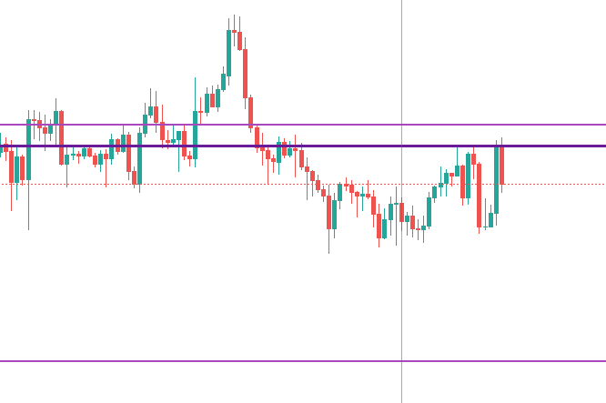

# Dankbit Light

Structural options analytics for Deribit — built on Odoo 18.

Collects every BTC and ETH options trade from Deribit and shows where the gamma and delta of that positioning sit across a range of prices: a static Delta/Gamma (GEX) chart per asset and two live TradingView-style gamma charts. Designed for understanding where dealers are structurally positioned — gamma walls, pin risk, and hedging pressure — not for tracking real-time flow.



---

## Pages

| URL | Description |
|---|---|
| `/BTC`, `/ETH` | Delta and Dollar Gamma (GEX) chart for all active expiries of the asset |
| `/4l/BTC`, `/4l/ETH` | Live candle chart with gamma levels for one expiry |
| `/ll/BTC`, `/ll/ETH` | Live candle chart with one gamma line per active expiry |

Every page requires an Odoo login.

### `/BTC`, `/ETH` — Delta and Gamma chart

| Curve | Colour | Description |
|---|---|---|
| Delta | Green | Aggregate taker portfolio delta across spot prices |
| Gamma (GEX) | Violet | Dollar gamma — `Γ × S²` — dealer hedging pressure; negative areas are filled |

Overlaid lines:

- **Blue** — current price (Coinbase spot)
- **Dashed black** — gamma peaks and troughs
- **Solid green / red** — prices where delta crosses zero (green: supply, red: demand)

The bottom-left corner shows the trade count and the time of the last trade. The page refreshes every 5 minutes by default (5 × the Refresh Interval setting).

**Reading the gamma curve:** negative GEX means takers are net short gamma → market makers are net long gamma → MMs sell into rallies and buy dips, pinning spot. The deepest trough is the primary gamma wall.

**Trading futures with GEX:**
- **Avoid directional trades when GEX is negative** (violet filled area) — MMs are net long gamma and hedge by fading every move. The market tends to pin and mean-revert. Breakouts fail.
- **Prefer directional trades when GEX is positive** (no fill) — MMs are net short gamma and must hedge pro-cyclically (buy into rallies, sell into dips), adding fuel to trending moves.

### `/4l/<asset>` — four-leg gamma

Coinbase spot candles (1h / 4h / 1d, 4h by default) with gamma levels computed from the trades of one expiry within a trailing window:

- **Gamma Legs** — where the gamma of each trade leg peaks: long call (LC), long put (LP), short call (SC), short put (SP)
- **Dominant Leg** — the leg with the most gamma
- **Delta 0** — prices where combined delta crosses zero
- **Gamma Flip** — prices where combined gamma changes sign
- **Gamma Peak** — the two strongest peaks/troughs of combined gamma
- **Max Pain** — from live Deribit open interest

Pick the expiry and window from the toolbar; each line set has its own checkbox, and colours can be changed under Settings.

### `/ll/<asset>` — dominant leg per expiry

Coinbase spot candles (1h / 4h / 1d, 4h by default) with one line per active expiry, drawn at the price of that expiry's dominant gamma leg. Lines are styled by how soon the expiry settles, and the strongest expiry can be shown alone or together with the others. Optional 1D/2D/3D lines show the strongest reading over the last 24/48/72 hours.

---

## Architecture

```
Deribit WebSocket API  ──►  dankbit_ws (Python)  ──►  PostgreSQL
                                                            │
                         Deribit / Coinbase REST  ──►  Odoo 18
                                                            │
                                            /BTC, /ETH, /4l/<asset>, /ll/<asset>
```

Two Docker services, plus PostgreSQL:

- **`web`** — Odoo 18 with the `dankbit` addon. Serves the chart pages and the Odoo backend.
- **`dankbit_ws`** — Lightweight Python service. Authenticates with Deribit's WebSocket API and streams option trades directly into PostgreSQL.

### Data sources

All prices come from **Coinbase spot**; Deribit is used only for options data.

| Data | Source |
|---|---|
| Candles (`/4l`, `/ll`) | Coinbase spot (`BTC-USD`, `ETH-USD`) |
| Current price (blue line on `/BTC`, `/ETH`) | Coinbase spot ticker |
| Option trades | Deribit (WebSocket, plus the optional REST backfill) |
| Option instrument lists | Deribit |
| Open interest (`/4l` Max Pain) | Deribit — Coinbase has no options |

---

## Setup

### Prerequisites

- Docker and Docker Compose
- Deribit API credentials

### 1. Clone

```bash
git clone https://github.com/fshahy/dankbit_light.git
cd dankbit_light
```

### 2. Create `.env`

```
DANKBIT_POSTGRES_DB=db1
POSTGRES_PASSWORD=<password>
DERIBIT_KEY=<key>
DERIBIT_SECRET=<secret>
UID=1000
GID=1000
```

`UID`/`GID` must match the host user that owns the project directory (`id -u`, `id -g`), so files Odoo writes are owned by you.

### 3. Create `config/odoo.conf`

`config/` is not in the repository, so create `config/odoo.conf` yourself:

```ini
[options]
addons_path = /mnt/my_addons
data_dir = /home/ubuntu/.local/share/Odoo
db_user = odoo
db_password = <same as POSTGRES_PASSWORD>
admin_passwd = <master password for the database manager>
dbfilter = ^db1$
http_interface = 0.0.0.0
```

Set `dbfilter` to match `DANKBIT_POSTGRES_DB`. Keep `data_dir` as shown: `docker-compose.yml` mounts `./odoo_filestore` there, so a different path leaves the filestore inside the container, where it is lost when the container is recreated. The database host is passed in by the container, so it isn't needed here.

### 4. Start

```bash
docker compose up -d
```

### 5. Initialise Odoo

Open `http://localhost:8069`, create a database with the name from `DANKBIT_POSTGRES_DB`, then install the **Dankbit** app from the Apps menu.

> The database starts empty. Trades accumulate in real time via the WebSocket service. Charts become more meaningful as more trades are collected — a fresh instance will show sparse data until enough history builds up.

### 6. Add trade indexes (recommended)

On a large trade table, create these by hand (they are not created on install):

```sql
CREATE EXTENSION IF NOT EXISTS pg_trgm;
CREATE INDEX CONCURRENTLY dankbit_trade_name_trgm ON dankbit_trade USING gin (name gin_trgm_ops);
CREATE INDEX CONCURRENTLY dankbit_trade_deribit_ts ON dankbit_trade (deribit_ts);
CREATE INDEX CONCURRENTLY dankbit_trade_expiration ON dankbit_trade (expiration);
```

### 7. Scheduled actions (optional)

Two scheduled actions ship **inactive**; enable them under Settings → Technical → Scheduled Actions:

- **Dankbit - Get Last Trades** — nightly; re-fetches recent trade history from the Deribit REST API to fill any gaps (e.g. during WebSocket downtime)
- **Dankbit - Delete Expired Trades** — daily; archives expired instruments

The WebSocket service (`dankbit_ws`) handles real-time ingestion automatically on startup.

### Updating

After changing Python code:

```bash
docker compose restart web
```

After changing views or model fields:

```bash
docker compose exec web /entrypoint.sh odoo -d <db_name> -u dankbit --stop-after-init --no-http
docker compose restart web
```

---

## Configuration

Settings → Dankbit:

| Parameter | Description | Default |
|---|---|---|
| From / To price (BTC) | Price range of BTC charts | 100,000 / 150,000 |
| Steps (BTC) | Price step size | 100 |
| From / To price / Steps (ETH) | Same for ETH | 2,000 / 5,000 / 50 |
| Refresh interval | Auto-refresh of live chart lines, in seconds | 60 |
| LL Other Expiries Min \|Gamma\| (M) | `/ll/BTC`: hide other expiries' lines below this gamma, in millions | 500 |
| Deribit API timeout | HTTP request timeout for Deribit calls and the Coinbase price lookup | 5 s |
| Deribit cache TTL | How long live prices and open interest are cached | 30–300 s, depending on the call |

---

## Stack

- **Odoo 18** — web framework, ORM, scheduler
- **PostgreSQL 14** — trade storage
- **matplotlib / numpy / scipy** — server-side chart rendering (no pyplot, Agg backend)
- **Lightweight Charts** — live candle charts
- **websockets** — Deribit WebSocket client
- **Docker Compose** — single-command deployment

---

## Project layout

```
dankbit_light/
├── my_addons/dankbit/
│   ├── controllers/
│   │   ├── main.py          # Chart pages and JSON APIs
│   │   ├── delta.py         # Black-Scholes delta aggregation
│   │   ├── gamma.py         # Dollar gamma (GEX) aggregation
│   │   └── options.py       # Payoff curves, per-leg gamma, chart figure
│   ├── models/
│   │   ├── trade.py         # Trade model, Deribit / Coinbase REST fetchers
│   │   ├── bands.py         # Active-expiry lookups
│   │   └── ir_http.py       # BTC/ETH URL converter
│   └── views/               # Page templates, backend views, settings
├── dankbit_ws_service/
│   └── dankbit_ws_batch.py  # WebSocket trade ingester
├── config/                  # odoo.conf (not committed)
└── docker-compose.yml
```

---

## License

MIT
